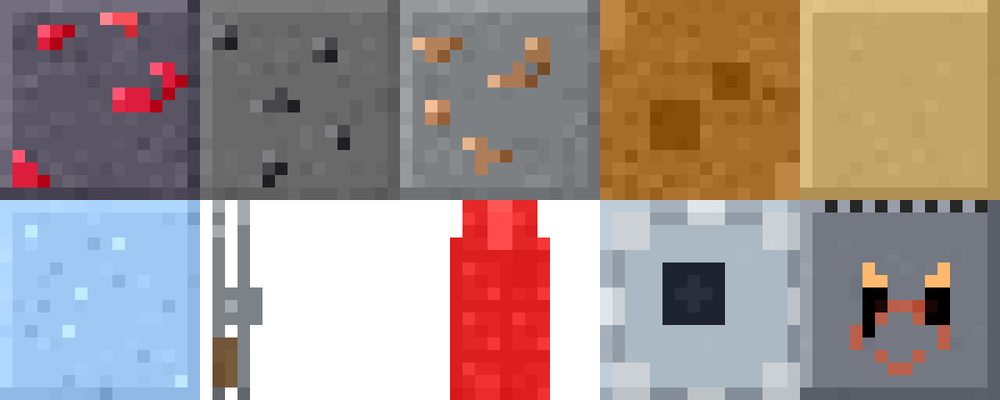

# 測試資料與測試結果

## A. 單元測試（假模型，不需要 LLM server）

指令：`python -m pytest tests`。最近一次結果：**64 passed**。

| 檔案 | 數量 | 測試內容 |
| --- | --- | --- |
| `test_texture_kit.py` | 15 | 繪圖函式（座標、溢位、ASCII 錯誤訊息、`speckle`、`gem_cluster`） |
| `test_agent_reply.py` | 14 | Agent 流程：純文字回覆、程式碼執行、重試、記憶、修改與匯出、回頭看、無 import 呼叫、自訂系統提示詞、案例執行器（含 `--only` 補跑與結果合併）、輸出上限與逾時 |
| `test_reference.py` / `test_reference_tool.py` | 12 / 4 | 參考材質索引、同步、檢索、Tool |
| `test_pack_features.py` | 9 | 版本存檔、品質檢查、主題記憶、資源包匯出 |
| `test_skill.py` | 4 | skill 載入與內容 |
| `test_ui.py` | 6 | 串流顯示、上傳參考材質 |

## B. Agent 實測（真模型 `dsv4p-qwen3.5:9b`）

測試資料：`documents/test-cases.json`（10 個案例）。批次執行：`python -m texture_agent.eval_cases`（只補跑部分案例用 `--only T09,T10`）。

「自動檢查」只判斷有沒有存出符合 kind 的檔、方塊類是否整張不透明，**不代表畫得好**。畫得好不好是「人工評分」，由人看圖判斷。

| ID | 輸入 | 預期 | 步數 | 失敗步數 | 秒 | 存檔 | 自動檢查 | 人工評分 | 觀察 |
| --- | --- | --- | --- | --- | --- | --- | --- | --- | --- |
| T01 | 紅寶石礦石 | 灰色石頭底鋪滿整張，上面有數簇紅色寶石，有明暗 | 2 | 0 | 133.5 | `ruby_ore.png` | Pass | 不及格（勉強能看） | 認得出是礦石；底色偏紫，簇的形狀凌亂 |
| T02 | 煤礦石 | 灰色石頭底，數簇深黑色煤塊，不能整張黑 | 4 | 0 | 292.4 | `coal_ore` v1–v3 | Pass | 不及格（勉強能看） | 灰底上只有幾個很小的黑點，太稀疏 |
| T03 | 銅礦石 | 灰色石頭底，數簇橘褐色銅點 | 4 | 0 | 289.7 | `copper_ore` v1–v3 | Pass | 不及格（勉強能看） | 十張裡最好；灰底加棕色簇，認得出 |
| T04 | 泥土方塊 | 單一棕色相，深淺顆粒，整張不透明 | 2 | 0 | 106.3 | `dirt.png` | Pass | 不及格（完全看不出來） | 橘棕色加深色塊，偏橘 |
| T05 | 橡木木板 | 淺棕色橫向木紋，板與板之間有較暗的縫 | 2 | 0 | 143.5 | `oak_planks.png` | Pass | 不及格（完全看不出來） | 一整塊淺棕色加亮邊，沒有木紋與板縫 |
| T06 | 玻璃 | 中間透明，邊框與少量高光不透明 | 3 | 1 | 219.3 | `glass.png` | Pass | 不及格（完全看不出來） | 整塊淡藍色不透明，像冰，不是玻璃 |
| T07 | 鐵劍 | 沿對角線的劍，劍身淺灰、握柄棕色，四周留透明 | 4 | 0 | 487.6 | `iron_sword` v1–v3 | Pass | 不及格（完全看不出來） | 只有貼在左邊緣的細直條與一點棕色，不是對角線的劍 |
| T08 | 紅色藥水瓶 | 直立玻璃瓶，下半有紅色液體，瓶口有軟木塞 | 6 | 2 | 1256.9 | `red_potion` v1–v3 | Pass | 不及格（完全看不出來） | 一根紅色長方塊，沒有瓶身輪廓與軟木塞 |
| T09 | 金屬齒輪 | 正面的圓形齒輪，外緣有齒，中間有孔 | 6 | 2 | 893.6 | `metal_gear` v1–v3 | **Fail** | 不及格（完全看不出來） | 淺藍灰方塊加中間一個深色方孔，沒有齒；模型還把 `kind` 存成 `block`（預期 `item`），所以自動檢查也失敗 |
| T10 | 發電機（機器方塊） | 金屬外殼的機器面，有散熱孔或指示燈等功能零件 | 5 | 1 | 543.7 | `generator` v1–v3 | Pass | 不及格（完全看不出來） | 灰色底加橘黑色、像臉的圖案，看不出是機器 |

統計：自動檢查通過 9/10（只代表有存檔）；**人工評分 0/10 及格**，其中 3 張（三種礦石）勉強能看，7 張完全看不出來。總步數 38、總耗時 4,366 秒（約 73 分鐘），沒有案例失控或逾時。有 6 個案例存了 v2、v3，代表評審迴圈用滿了 2 次重畫，但重畫後結果仍然不好。

### 結論

- 有現成函式可用的礦石類（`speckle`、`gem_cluster`）能畫到「勉強認得出」；沒有現成函式的物品與機器（T07–T10）完全畫不出形狀，連玻璃、木板這類方塊也不行。
- 9B 的「回頭看」幾乎抓不出問題：多數案例重畫兩次後仍然不及格。
- 這與第一次批次測試的失控事故（`failure-cases.md` 失敗 5）一起，說明目前的瓶頸是模型本身的能力，而不只是提示詞或 Tool 的設計。

### 歷史紀錄：Tool 改版前後（只有 T01 有完整對照）

| | 步數 | 耗時 | 失敗步數 |
| --- | --- | --- | --- |
| 改版前（run1） | 9 | 1,040 秒 | 5 |
| 改版後（run2，單獨跑） | 2 | 72.6 秒 | 0 |
| 批次測試中的 T01 | 2 | 133.5 秒 | 0 |
